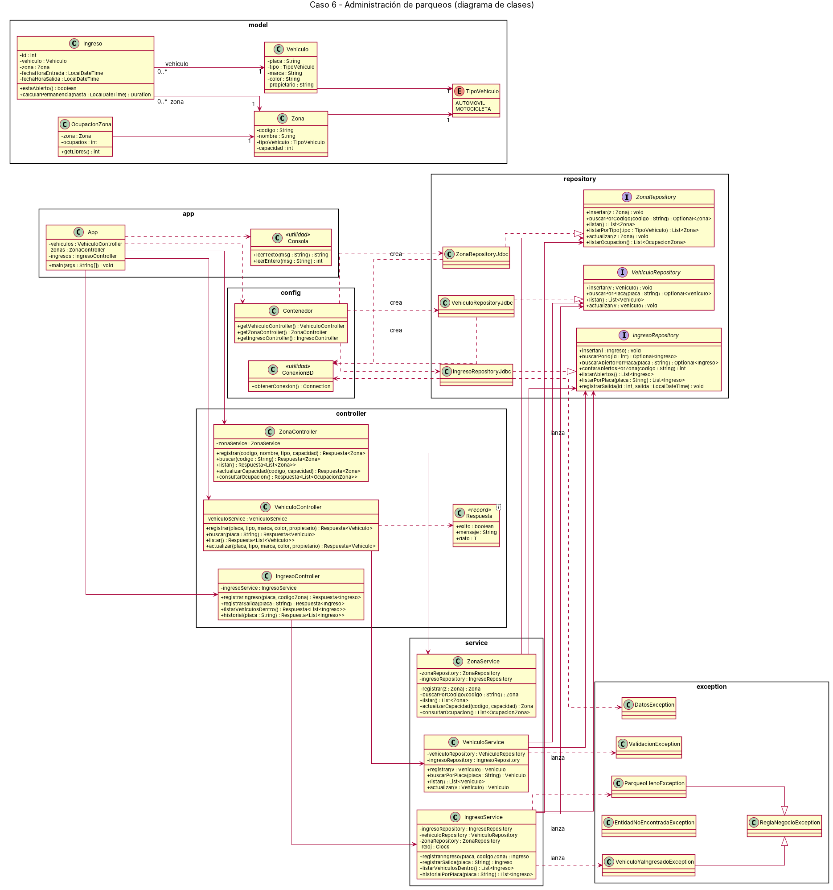
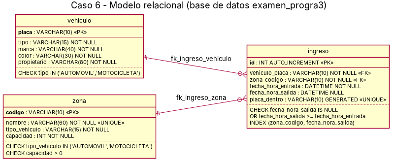

# Etapa 1 — Análisis, diseño y arquitectura

## 9.1 Identificación

```text
Caso asignado:       Caso 6 — Administración de parqueos
Integrante 1:        Sadrak Cerdas Cedeño
Integrante 2:        Freyman Guzmán Cortes
Integrante 3:        Andrey Gómez Alfaro
URL del repositorio: https://github.com/FreymanGC/examen1progra3-cerdas-guzman-gomez
```

## 9.2 Descripción del problema

**Problema que se desea resolver:**

El parqueo institucional tiene zonas separadas para automóviles y para motocicletas, cada una con una cantidad limitada de espacios. Hoy el control de quién entra y quién sale se lleva de forma manual, por lo que es posible que una zona reciba más vehículos de los que caben, que un vehículo quede registrado dos veces como "dentro", o que una motocicleta se anote en una zona de automóviles. El sistema registra cada ingreso y cada salida en una base de datos MySQL y aplica esas reglas automáticamente antes de aceptar un ingreso.

**Quién utilizaría el sistema:**

El oficial de seguridad que atiende la caseta de ingreso. Desde un menú de consola registra los vehículos autorizados, administra las zonas, anota los ingresos y salidas y consulta en cualquier momento qué vehículos están dentro y cuántos espacios quedan libres.

**Principales operaciones:**

- Registrar, consultar, listar y actualizar vehículos autorizados.
- Registrar, consultar, listar y actualizar la capacidad de las zonas.
- **Registrar el ingreso de un vehículo** (operación de negocio principal), eligiendo una zona o dejando que el sistema asigne la primera zona del tipo correcto que tenga espacio.
- Registrar la salida de un vehículo y calcular su tiempo de permanencia.
- Consultar los vehículos que están dentro del parqueo (JOIN `ingreso`–`vehiculo`–`zona`).
- Consultar los espacios ocupados y libres por zona (LEFT JOIN + COUNT).
- Consultar el historial de ingresos de un vehículo (filtro por placa).

## 9.3 Requerimientos funcionales

```text
RF-01. El sistema permitirá registrar un vehículo autorizado con placa, tipo, marca, color y propietario.
RF-02. El sistema permitirá consultar un vehículo por su placa.
RF-03. El sistema permitirá listar todos los vehículos autorizados.
RF-04. El sistema permitirá actualizar la marca, el color, el propietario y el tipo de un vehículo.
RF-05. El sistema permitirá registrar una zona con código, nombre, tipo de vehículo y capacidad.
RF-06. El sistema permitirá consultar una zona por su código y listar todas las zonas.
RF-07. El sistema permitirá actualizar la capacidad de una zona.
RF-08. El sistema permitirá registrar el ingreso de un vehículo autorizado en una zona de su tipo que tenga espacio, con la fecha y hora actual.
RF-09. El sistema permitirá registrar la salida de un vehículo que esté dentro e informará su tiempo de permanencia.
RF-10. El sistema permitirá consultar los vehículos que se encuentran dentro del parqueo.
RF-11. El sistema permitirá consultar, por zona, los espacios ocupados y los espacios libres.
RF-12. El sistema permitirá consultar el historial de ingresos y salidas de un vehículo.
```

## 9.4 Reglas de negocio

| ID | Regla | Operación donde se aplica | Qué ocurre si se viola |
|---|---|---|---|
| RN-01 | No se puede superar la capacidad máxima de una zona: la cantidad de ingresos abiertos de la zona debe ser menor que su capacidad. | Registrar ingreso | Se rechaza con `ParqueoLlenoException` |
| RN-02 | Un vehículo no puede ingresar si ya está dentro (tiene un ingreso sin salida). | Registrar ingreso | Se rechaza con `VehiculoYaIngresadoException` |
| RN-03 | Un vehículo solo puede ocupar una zona de su mismo tipo (automóvil o motocicleta). | Registrar ingreso | Se rechaza con `ReglaNegocioException` |
| RN-04 | Solo se puede registrar la salida de un vehículo que esté dentro. | Registrar salida | Se rechaza con `ReglaNegocioException` |
| RN-05 | No se puede cambiar el tipo de un vehículo mientras está dentro del parqueo (quedaría en una zona de otro tipo). | Actualizar vehículo | Se rechaza con `ReglaNegocioException` |
| RN-06 | La capacidad de una zona no puede reducirse por debajo de la cantidad de vehículos que tiene dentro. | Actualizar capacidad de zona | Se rechaza con `ReglaNegocioException` |
| RN-07 | Solo pueden ingresar vehículos registrados como autorizados. | Registrar ingreso | Se rechaza con `EntidadNoEncontradaException` |

Validaciones de datos (lanzan `ValidacionException`): placa obligatoria de 3 a 10 caracteres (letras, números o guion), placa y código de zona no repetidos, campos de texto obligatorios con longitud máxima, capacidad entre 1 y 500.

## 9.5 Entidades, atributos y relaciones

| Clase | Responsabilidad | Atributos principales |
|---|---|---|
| `Vehiculo` | Vehículo autorizado para usar el parqueo | `placa`, `tipo`, `marca`, `color`, `propietario` |
| `Zona` | Sección del parqueo para un único tipo de vehículo | `codigo`, `nombre`, `tipoVehiculo`, `capacidad` |
| `Ingreso` | Estadía de un vehículo: abierta mientras no tenga salida | `id`, `vehiculo`, `zona`, `fechaHoraEntrada`, `fechaHoraSalida` |
| `OcupacionZona` | Resultado de consulta: zona + vehículos dentro + espacios libres | `zona`, `ocupados` (calcula `getLibres()`) |

| Clases relacionadas | Tipo de relación | Multiplicidad | Explicación |
|---|---|---|---|
| `Ingreso` → `Vehiculo` | Asociación | `0..*` a `1` | Cada ingreso corresponde a un vehículo; un vehículo puede tener muchos ingresos en su historial, pero como máximo uno abierto (RN-02). |
| `Ingreso` → `Zona` | Asociación | `0..*` a `1` | Cada ingreso ocupa una zona; una zona tiene muchos ingresos, pero sus ingresos abiertos no pueden superar la capacidad (RN-01). |
| `Vehiculo` → `TipoVehiculo` | Asociación con enumeración | `1` | Todo vehículo es automóvil o motocicleta. |
| `Zona` → `TipoVehiculo` | Asociación con enumeración | `1` | Cada zona acepta un solo tipo (RN-03). |
| `OcupacionZona` → `Zona` | Asociación | `1` | Envuelve una zona con su ocupación actual. |

**Enumeraciones:**

```java
public enum TipoVehiculo {
    AUTOMOVIL("Automóvil"),
    MOTOCICLETA("Motocicleta");
}
```

**Decisiones de diseño respecto al caso sugerido:**

- Se agregó el atributo `nombre` a `Zona` para que el oficial identifique las zonas con facilidad (por ejemplo, "Zona A - Automóviles norte").
- No se guarda un "estado" en `vehiculo`: que un vehículo esté dentro se deduce de que tenga un `ingreso` con `fecha_hora_salida` en `NULL`. Así la información no se duplica y ninguna operación necesita modificar dos tablas a la vez.
- Se agregó la clase `OcupacionZona` para representar el resultado de la consulta de espacios libres sin mezclar datos calculados dentro de `Zona`.
- Al registrar un ingreso, el oficial puede escribir el código de la zona o dejarlo vacío; en ese caso el sistema elige la primera zona del tipo del vehículo con espacio (paso 3 del caso).

## 9.6 Diagrama de clases UML

Archivo: `docs/etapa_1/diagramas/uml.png` (fuente PlantUML: `uml.puml`)



## 9.7 Modelo relacional

Archivo: `docs/etapa_1/diagramas/modelo_relacional.png` (fuente PlantUML: `modelo_relacional.puml`)



Script preliminar: [`database/schema.sql`](../../database/schema.sql)

Restricciones destacadas:

- `CHECK (capacidad > 0)` en `zona` y `CHECK` de valores válidos para los tipos.
- `CHECK (fecha_hora_salida IS NULL OR fecha_hora_salida >= fecha_hora_entrada)` en `ingreso`.
- Columna calculada `placa_dentro` con `UNIQUE`: vale la placa mientras el ingreso está abierto y `NULL` cuando se cierra. Como MySQL permite varios `NULL` en un índice `UNIQUE`, la base de datos impide dos ingresos abiertos del mismo vehículo, reforzando RN-02. La regla igualmente se valida primero en `IngresoService`.

## 9.8 Arquitectura propuesta

```text
App (consola) → Controller → Service → Repository (interface) → RepositoryJdbc → MySQL
```

| Capa | Clases | Responsabilidad |
|---|---|---|
| `model` | `Vehiculo`, `Zona`, `Ingreso`, `OcupacionZona`, `TipoVehiculo` | Representar los datos del parqueo; no usan `java.sql` ni la consola. |
| `repository` | `VehiculoRepository`, `ZonaRepository`, `IngresoRepository` (interfaces) y `VehiculoRepositoryJdbc`, `ZonaRepositoryJdbc`, `IngresoRepositoryJdbc` | Todo el SQL: `PreparedStatement`, `try-with-resources` y conversión de `ResultSet` a objetos (`mapear`). Sin reglas de negocio. |
| `service` | `VehiculoService`, `ZonaService`, `IngresoService` | Validar datos y aplicar las reglas RN-01 a RN-07. Reciben las interfaces de repositorio por constructor. |
| `controller` | `VehiculoController`, `ZonaController`, `IngresoController`, `Respuesta<T>` | Recibir la solicitud de la consola, invocar al servicio y convertir resultados o excepciones en una `Respuesta` con un mensaje claro. |
| `exception` | `ValidacionException`, `ReglaNegocioException`, `ParqueoLlenoException`, `VehiculoYaIngresadoException`, `EntidadNoEncontradaException`, `DatosException` | Representar los errores de validación, de reglas de negocio y de acceso a datos. |
| `config` | `ConexionBD`, `Contenedor` | Conexión JDBC (dada por el docente) y armado de las dependencias (crea las clases JDBC y las inyecta como interfaces). |
| `app` | `App`, `Consola` | Menú de consola: leer datos y mostrar resultados. |

**Interfaces Repository/DAO definidas:**

```java
public interface IngresoRepository {

    /** Inserta el ingreso y le asigna el id generado por la base de datos. */
    void insertar(Ingreso ingreso);

    Optional<Ingreso> buscarPorId(int id);

    /** Ingreso sin salida del vehículo indicado, si existe. */
    Optional<Ingreso> buscarAbiertoPorPlaca(String placa);

    /** Cantidad de vehículos que están dentro de la zona en este momento. */
    int contarAbiertosPorZona(String codigoZona);

    /** Vehículos que están dentro del parqueo (JOIN vehiculo + zona). */
    List<Ingreso> listarAbiertos();

    /** Historial de ingresos de un vehículo, del más reciente al más antiguo. */
    List<Ingreso> listarPorPlaca(String placa);

    void registrarSalida(int idIngreso, LocalDateTime fechaHoraSalida);
}
```

Las otras dos interfaces (`VehiculoRepository` y `ZonaRepository`) están en `proyecto/src/main/java/cr/ac/una/repository/`.

## Código de la Etapa 1

- [x] Clases del modelo (atributos privados, constructores, getters/setters, `toString()`).
- [x] Enumeraciones.
- [x] Interfaces `Repository`/`DAO`.
- [x] Estructura de `Service` y `Controller`.
- [x] Excepciones personalizadas.
- [x] El proyecto compila.

## Distribución del trabajo

| Integrante | Aportes principales |
|---|---|
| Sadrak Cerdas Cedeño | Modelo (`Vehiculo`, `Zona`, `Ingreso`, `OcupacionZona`), enumeración `TipoVehiculo` y excepciones personalizadas. |
| Freyman Guzmán Cortes | Interfaces de repositorio, script SQL preliminar, modelo relacional. |
| Andrey Gómez Alfaro | Estructura de `Service` y `Controller`, diagrama UML y este documento de análisis. |
